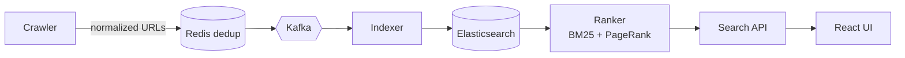
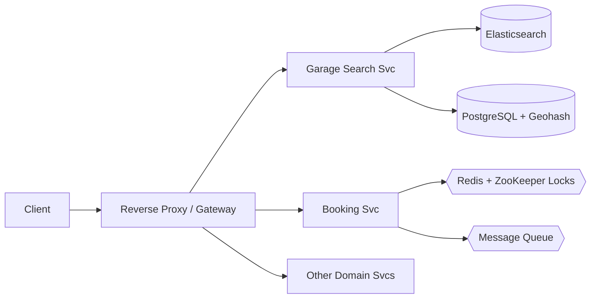

# Aakash Jung Rayamajhi

**Software Engineer · Backend & Distributed Systems**

Building scalable, fault-tolerant systems and AI-powered automation.

---

## About

Hi, I'm **Aakash Jung Rayamajhi**, a Software Engineer from Nepal and a BSc CSIT graduate (Tribhuvan University, NePathya College, 2022–2026).

I'm building myself into a **T-shaped / Pi-shaped engineer**: deep expertise in **JavaScript/TypeScript and Python**, backed by a wide working knowledge of the IT ecosystem, from backend infrastructure to mobile, cloud and AI. I like turning hard system-design problems into things that actually run: scalable, fault-tolerant and observable.

**What I build**
- **Backend & distributed systems**: microservices, event-driven pipelines with Kafka, distributed locks (Redis + ZooKeeper), search with Elasticsearch, and geo-aware services
- **Full-stack products**: MERN stack web apps and cross-platform mobile apps with React Native (Expo)
- **AI integrations & agents**: RAG systems, LLM-powered features, speech/translation pipelines, chatbots, and AI-agent workflow automation (OpenAI APIs, LangChain, n8n)
- **Reliability**: monitoring and load testing with Prometheus, Grafana, k6 and JMeter; CI/CD with Docker, Kubernetes and GitHub Actions

**What I'm doing now**
- Going deeper on system design: consistency, concurrency, caching and scaling trade-offs
- Strengthening my core in JavaScript/TypeScript and Python (DSA, backend internals, async patterns)
- Building AI agents and automation that solve real workflow problems
- Preparing to become an **open-source contributor**: reading codebases, fixing issues, shipping PRs

**Beyond the core**: I also explore the wider stack, including Next.js, NestJS, Vue, Django/FastAPI, Spring, Three.js/WebGL, Supabase/Firebase and Figma, and I enjoy experimenting, learning and building in public.

**Ask me about**: designing distributed search, preventing double-bookings with distributed locks, microservice fault tolerance, RAG pipelines, and competitive programming.

---

## Featured Projects

### SkySearch: Distributed Search Engine
Crawling → Indexing → Ranking, split into independently scalable microservices.

- Scaled the 3 pipeline stages (crawl, index, rank) independently as separate microservices
- Cut redundant crawling with 2-stage dedup: URL normalization, then Redis in-memory check before queueing
- Isolated failures between services using Apache Kafka queues
- Sub-second relevance scoring with a hybrid ranker: **BM25 + PageRank** over an inverted index
- Async background workers for payload processing; Elasticsearch for retrieval

`Node.js` `Express` `React` `Kafka` `Elasticsearch` `Redis` `PostgreSQL` `Docker`

### e-Mistiri: Vehicle Servicing Platform
Microservices backend for discovering and booking vehicle service garages.

- Partitioned backend into domain microservices with isolated data stores for independent deployment
- Narrowed nearby-garage search using **Geohashing + PostgreSQL spatial indexes**
- Separated search load (Elasticsearch) from transactional load (PostgreSQL)
- Prevented double-bookings with **distributed locks** (Redis + ZooKeeper, TTL expiry)
- Improved fault tolerance with async queues, circuit breakers and reverse-proxy routing

`Node.js` `Express` `React` `MongoDB` `PostgreSQL` `Elasticsearch` `Redis` `ZooKeeper` `Docker`

> More projects and write-ups: **[aakashrayamajhi.com.np](https://aakashrayamajhi.com.np)**

---

## Tech Stack

| | |
|---|---|
| **Languages** |       |
| **Backend** |      |
| **Distributed Systems** |     |
| **Databases** |    |
| **Cloud & DevOps** |      |
| **Frontend** |     |
| **AI & Automation** |      |
| **Monitoring & Testing** |     |

---

## Achievements

- **National Hackathon: 2nd Runner-up**. Built speech transcription, automated translation, a RAG-based Q&A system and a WhatsApp conversational chatbot
- **Nepathon Advisor**. Guided teams on technical execution and infrastructure planning at a national hackathon
- **LeetCode Contests**. Ranked under 100 multiple times in weekly and biweekly contests
- **500+ problems solved** (300+ on LeetCode) across LeetCode, HackerRank and Codeforces
- **Esports leadership (2019–2022)**. In-Game Leader; Top 3 in FFIC 2021 Fall Open Qualifier, Top 20 in FFPL Summer 2021, representing Nepal internationally

---

## GitHub Activity

---

**Open to internships and backend / distributed-systems roles.**
Let's build something scalable. → [aakashrayamajhi03@gmail.com](mailto:aakashrayamajhi03@gmail.com)

